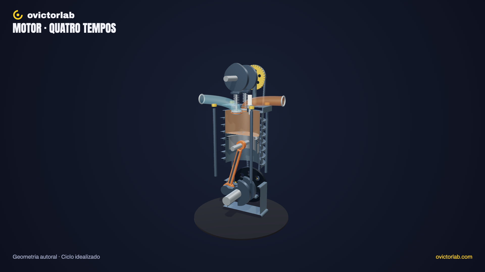

# Motor por dentro

**[Abrir a experiência →](https://victorsodre.github.io/motor-por-dentro/)** · [Os 10 experimentos](docs/COLECAO.md) · [Publicação e manutenção](docs/PUBLICACAO.md)

[](https://victorsodre.github.io/motor-por-dentro/)

**Como o movimento dentro do cilindro chega ao eixo?**

Um cilindro de um motor quatro tempos de tipo declarado, com pistão, biela, virabrequim e válvulas. Turbo e alimentação diesel ficam em módulos posteriores, com sua própria apuração.

Direção e autoria editorial: **Victor Sodré / ovictorlab**. [Site](https://ovictorlab.com/) · [Referência Fusquinha](https://victorsodre.github.io/fusquinha/) · [Repositório](https://github.com/victorsodre/motor-por-dentro).

## Por que desenvolver

No YouTube, o Short sobre ar no sistema diesel tinha 7.858 visualizações e o de turbo, 3.667. São módulos futuros relacionados; o primeiro corte terá um único tipo de motor. Consulta em 07/11/2026. Métricas acumuladas são sinais de interesse; não comprovam demanda pelo aplicativo ou alcance orgânico.

- [Ar no diesel — YouTube](https://www.youtube.com/watch?v=tpEJraM4_PI)
- [Turbo — YouTube](https://www.youtube.com/watch?v=Cq8wFJlB6Gk)

## Começar por aqui

1. [Escopo e critérios de conclusão](docs/ESCOPO.md).
2. [Lista de execução](docs/EXECUCAO.md).
3. [Identidade visual do ovictorlab](docs/IDENTIDADE-VISUAL.md).
4. [Arquitetura proposta e reaproveitamento do Fusquinha](docs/ARQUITETURA.md).
5. [Assets, fontes e pendências de apuração](docs/ASSETS-E-FONTES.md).
6. [Manutenção, validação e publicação](docs/MANUTENCAO.md).
7. [Decisões e estado do projeto](docs/DECISOES.md).
8. [Textos para o X](POSTAGENS-X.md) e [ordem da coleção](docs/COLECAO.md).

## Versão entregue

Motor educativo de quatro tempos, ignição por centelha e comando no cabeçote. Oito conjuntos autorais, um controle de 0–720°, quatro fases, três velocidades didáticas, corte, desmontagem reversível e pausa. Pistão, biela, eixo, cames e válvulas derivam do mesmo ângulo.

Busca, seleção na lista/cena, isolamento, foco, tour, malha, tela cheia e PNG 16:9/9:16 completam a exploração. O vídeo de turbo é um tema relacionado do canal; turbo e diesel não fazem parte do mecanismo desta versão.

## Executar

Node.js 22.18 ou superior; versões exatas no lockfile.

```sh
npm ci
npm run dev
npm test
npm run check
npm run build
npm run preview
```

`dev`: http://127.0.0.1:4311/ . `preview` informa a porta. Build estático em `dist/`, com base relativa e subpasta conferida. Não há backend, LLM, credenciais ou uso da GPU de produção.

## Evidências e limites

[APURACAO.md](docs/APURACAO.md) registra fontes primárias, geometria e simplificações. [VALIDACAO.md](docs/VALIDACAO.md) registra oito testes, 105 verificações de navegador e imagens inspecionadas. Validação móvel por viewport no Chrome do Mac; não houve ensaio em telefone físico.

A experiência não calcula combustão, pressão, torque, potência ou diagnóstico. Levantamentos, dimensões e velocidade são ilustrativos; centelha em 360° e válvulas sem cruzamento. Não é réplica de um motor comercial.

Guias de manutenção e identidade permanecem em `docs/`. Publicação e divulgação são etapas posteriores; [POSTAGENS-X.md](POSTAGENS-X.md) contém rascunhos condicionados ao estado real.
